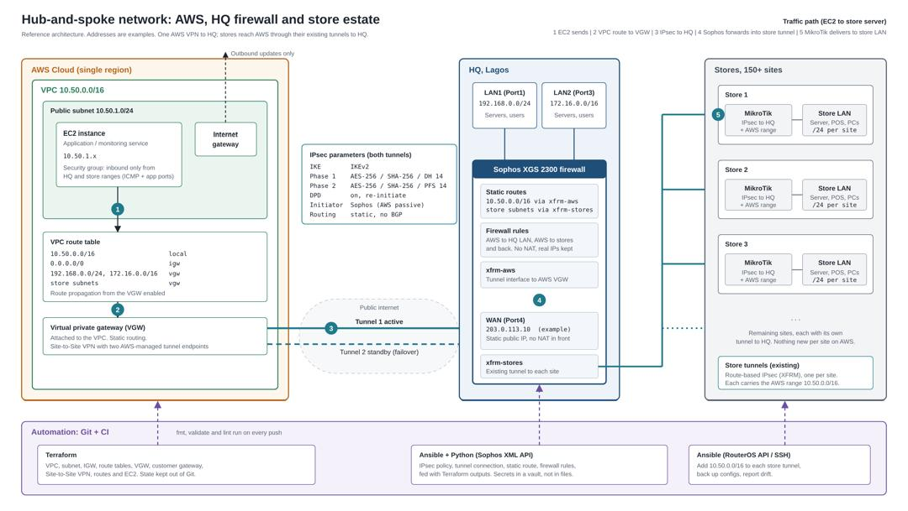

# Multi-Vendor Network Automation

Terraform, Ansible and Python automation for a hub-and-spoke network that connects **AWS**, a **Sophos** HQ firewall and a **MikroTik**-based store estate of 150+ sites.

AWS gets **one** Site-to-Site VPN, to the HQ Sophos firewall. Stores already tunnel to HQ, so workloads on AWS reach store servers through HQ. There is no separate AWS VPN per store, which keeps cost and operations low.



> All addresses in this repository are examples (`203.0.113.0/24` is a reserved documentation range). Real addresses, preshared keys and Terraform state are never committed.

## What it does

- Builds the AWS network foundation as code: VPC, public subnet, internet gateway and route tables
- Builds the Site-to-Site VPN to the HQ firewall: customer gateway, virtual private gateway, VPN connection with pinned IKEv2 settings, static routes and route propagation
- Exposes tunnel addresses and keys as Terraform outputs, so device configuration can be fed from code instead of copied by hand
- Documents the full design, routing and failure modes in [`docs/architecture.md`](docs/architecture.md)

## Status

| Area | Status |
|---|---|
| AWS VPC, subnet, internet gateway, route tables (Terraform) | Done |
| Site-to-Site VPN to HQ with pinned IPsec parameters (Terraform) | Done |
| Architecture diagram and documentation | Done |
|Ansible setup and Sophos API connection test | Done |
| Sophos configuration through the XML API (Python and Ansible) | Done|
| EC2 instance and security group module | Planned |
| MikroTik store configuration (Ansible, RouterOS API or SSH) | Planned |
| CI checks (`terraform fmt`, `validate`, lint) | Planned |

## Repository layout

```
.
├── terraform/
│   └── environments/
│       └── dev/              VPC, VPN, variables, outputs
├── ansible/                  Playbooks for Sophos and MikroTik (planned)
├── python/                   Sophos XML API client (planned)
├── templates/                Jinja2 device templates (planned)
├── docs/
│   ├── architecture.md       Design, routing, security, failure modes
│   └── architecture.png      Diagram
└── README.md
```

## Design in short

1. EC2 sends traffic for a store server.
2. The VPC route table sends it to the virtual private gateway.
3. It crosses the IPsec tunnel to the HQ Sophos firewall. A second tunnel is on standby.
4. The Sophos forwards it into the store's existing tunnel, with no NAT, so real source addresses are kept.
5. The store MikroTik router delivers it to the store LAN. Replies return the same way.

Routes must exist on AWS, on the Sophos, and on every store router. A tunnel can show UP while pings still fail if one side is missing a route. See [`docs/architecture.md`](docs/architecture.md) for details.

## IPsec parameters

| Setting | Value |
|---|---|
| IKE version | IKEv2 |
| Phase 1 | AES-256, SHA-256, DH group 14 |
| Phase 2 | AES-256, SHA-256, PFS group 14 |
| Dead peer detection | On |
| Initiator | Sophos (the AWS side is passive) |
| Routing | Static, no BGP |

## Getting started

### Requirements

- Terraform 1.5 or later
- An AWS account and an IAM user with permission to create VPC and VPN resources (do not use the root account)
- AWS credentials configured locally (`aws configure`)
- The static public IP of your firewall

### Run it

```bash
git clone https://github.com/olusegab/multi-vendor-network-automation.git
cd multi-vendor-network-automation/terraform/environments/dev

cp terraform.tfvars.example terraform.tfvars
# edit terraform.tfvars and set sophos_public_ip to your firewall's public IP

terraform init
terraform validate
terraform plan
terraform apply
```

After `apply`, read the tunnel details you need for the firewall:

```bash
terraform output tunnel1_address
terraform output tunnel1_cgw_inside_address
terraform output -raw tunnel1_preshared_key
```

### Clean up

A Site-to-Site VPN connection is billed for every hour it exists, whether or not traffic flows. Destroy lab resources when you finish:

```bash
terraform destroy
```

## Security

- `terraform.tfstate`, `.terraform/` and `terraform.tfvars` are in `.gitignore`. Only `terraform.tfvars.example`, with fake values, is committed.
- Preshared keys are marked `sensitive` and are only shown when you ask for them.
- Use an IAM user with least privilege, not the AWS root account.
- Keep the Sophos API restricted to the automation host's IP, with a dedicated account.

## Roadmap

- EC2 and security group module with a ping test to an HQ server and a store server
- Python client for the Sophos XML API, starting with read-only calls
- Ansible playbooks with Jinja2 templates, fed by Terraform outputs
- MikroTik playbook that adds the AWS range to each store tunnel and backs up configs
- GitHub Actions for `terraform fmt`, `validate` and lint on every push

## Related project

[Abayonet](https://github.com/olusegab/abayonet): the network monitoring system used alongside this estate.

## Author

Olusegun Abayomi Stephen, Network Automation and Cybersecurity Engineer
[LinkedIn](https://linkedin.com/in/abayormi) · [GitHub](https://github.com/olusegab)

## License

TODO: add a `LICENSE` file 
