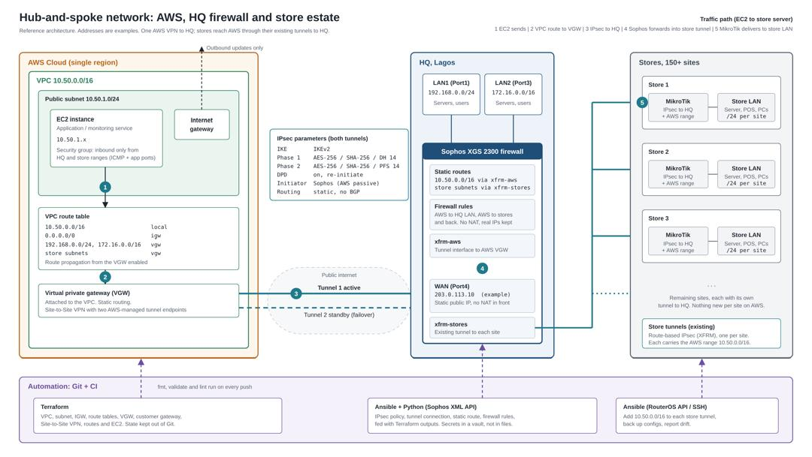

# Multi-Vendor Network Automation

Terraform and Ansible automation for a hub-and-spoke network that connects **AWS**, a **Sophos** HQ firewall and a **MikroTik**-based store estate of 150+ sites.

AWS gets **one** Site-to-Site VPN, to the HQ Sophos firewall. Each store gets its own IPsec tunnel to HQ, created by Ansible. Workloads on AWS reach store servers through HQ, so there is no separate AWS VPN per store, which keeps cost and operations low.



> All addresses in this repository are examples (`203.0.113.0/24` and `198.51.100.0/24` are reserved documentation ranges). Real addresses, preshared keys and Terraform state are never committed.

## What it does

- Builds the AWS network foundation as code: VPC, public subnet, internet gateway and route tables
- Builds the Site-to-Site VPN to the HQ firewall: customer gateway, virtual private gateway, VPN connection with pinned IKEv2 settings, static routes and route propagation
- Configures the Sophos firewall through its API with Ansible: network objects and the IPsec connection for the AWS tunnel and for each store
- Configures the MikroTik store router with Ansible over SSH: IKE profile, proposal, peer, identity, IPsec policies and the NAT exemption
- Keeps preshared keys in Ansible Vault, one key per store
- Documents the full design, routing and failure modes in [`docs/architecture.md`](docs/architecture.md)

## Status

| Area | Status |
|---|---|
| AWS VPC, subnet, internet gateway, route tables (Terraform) | Done |
| Site-to-Site VPN to HQ with pinned IPsec parameters (Terraform) | Done |
| Architecture diagram and documentation | Done |
| Sophos: network objects and IPsec connection (Ansible) | Done for the AWS tunnel and one pilot store |
| MikroTik: store side of the tunnel (Ansible) | Done for one pilot store, safe to re-run |
| AWS range added to the store connections and firewall rules on the Sophos | Planned |
| Rollout to the remaining stores from the inventory, one key per store | Planned |
| EC2 instance and security group, ping test from AWS to a store server | Planned |
| CI checks (`terraform fmt`, `validate`, `ansible-lint`) | Planned |

## Repository layout

```
.
├── terraform/
│   └── environments/
│       └── dev/              VPC, VPN, variables, outputs
├── ansible/
│   ├── inventory/            hosts and group variables (real files are git-ignored)
│   ├── playbooks/            connection tests, Sophos and MikroTik playbooks
│   ├── vars/                 local settings (real file is git-ignored)
│   ├── collections/          required Ansible collections
│   └── requirements.txt      Python packages
├── docs/
│   ├── architecture.md       Design, routing, security, failure modes
│   └── architecture.png      Diagram
└── README.md
```

## Design in short

1. EC2 sends traffic for a store server.
2. The VPC route table sends it to the virtual private gateway.
3. It crosses the IPsec tunnel to the HQ Sophos firewall. A second tunnel is on standby.
4. The Sophos forwards it into the store's tunnel, with no NAT, so real source addresses are kept.
5. The store MikroTik router delivers it to the store LAN. Replies return the same way.

Routes and tunnel networks must agree on every device: AWS, the Sophos connection for the store, and the store router's policies. A tunnel can show UP while pings still fail if one side lists different networks or is missing a route. See [`docs/architecture.md`](docs/architecture.md) for details.

## IPsec parameters

| Setting | Value |
|---|---|
| IKE version | IKEv2 |
| Phase 1 | AES-256, SHA-256, DH group 14 |
| Phase 2 | AES-256, SHA-256, PFS group 14 |
| Store tunnel lifetimes | Phase 1 8 hours, phase 2 1 hour |
| Dead peer detection | On, re-initiate |
| Initiator | Sophos |
| Routing | Static, no BGP |

## Getting started

### Terraform (AWS)

Requirements: Terraform 1.5 or later, an AWS account with an IAM user that can create VPC and VPN resources (not the root account), credentials configured with `aws configure`, and the static public IP of your firewall.

```bash
git clone https://github.com/olusegab/multi-vendor-network-automation.git
cd multi-vendor-network-automation/terraform/environments/dev

cp terraform.tfvars.example terraform.tfvars
# edit terraform.tfvars and set sophos_public_ip to your firewall's public IP

terraform init
terraform validate
terraform plan
terraform apply
```

A Site-to-Site VPN connection is billed for every hour it exists, whether or not traffic flows. Run `terraform destroy` when you finish a lab.

### Ansible (Sophos and MikroTik)

Requirements: Python 3, a Sophos firewall with the XML API enabled for the automation host's IP, and SSH access to the store router from the HQ network.

```bash
cd ansible
python3 -m venv ~/venvs/netauto && source ~/venvs/netauto/bin/activate
pip install -r requirements.txt
ansible-galaxy collection install -r collections/requirements.yml

cp inventory/hosts.example.yml inventory/hosts.yml        # your real addresses
cp vars/local.example.yml vars/local.yml                  # your real settings
ansible-vault create inventory/group_vars/all/vault.yml   # keys and passwords

# read-only checks first
ansible-playbook playbooks/00_sophos_connection_test.yml --ask-vault-pass
ansible-playbook playbooks/10_mikrotik_connection_test.yml --ask-vault-pass

# then build one store tunnel, Sophos first so both ends use the same key
ansible-playbook playbooks/02_create_apo_tunnel_sophos.yml --ask-vault-pass
ansible-playbook playbooks/03_create_apo_tunnel_mikrotik.yml --ask-vault-pass
```

Run the MikroTik playbook a second time. It should report `changed=0`, which shows it is safe to repeat.

## Known issues and workarounds

- **Sophos Ansible module (collection 2.5.2, SFOS 22.0.2):** `connection: true` raises a `TypeError` while the module reads the reply, after the request has already been sent. The playbook tolerates exactly that error and fails on any other. The gateway type was also found set to "Respond only" after an update, so the playbook sets it again explicitly.
- **RouterOS 6.49:** `find` does not match NAT rules by address. Rules created by Ansible carry a unique comment tag, and the playbook looks them up by that tag.
- **RouterOS 6.49 SSH:** the router offers only `hmac-sha1` and `hmac-md5`, which the libssh client rejects. The inventory sets `ansible_network_cli_ssh_type: paramiko`.
- **RouterOS terminal:** long commands are echoed back into the output. The playbook builds its "added" marker at run time and ends with a read-back that counts the objects and fails if any is missing.

## Security

- `terraform.tfstate`, `.terraform/`, `terraform.tfvars`, `inventory/hosts.yml`, `vars/local.yml` and every `vault.yml` are in `.gitignore`. Only example files with fake values are committed.
- Preshared keys are generated once and kept in Ansible Vault. Each store gets its own key.
- Use an IAM user with least privilege, not the AWS root account.
- The Sophos API is limited to the automation host's IP, with a dedicated least-privilege account.
- Store routers accept SSH only from the HQ public IP, through a dedicated automation account that is read-only unless a change is being made.

## Roadmap

- Add the AWS range to the Sophos store connections and firewall rules
- Create all remaining store tunnels from the inventory in one run, with a separate key per store
- EC2 and security group module with a ping test to an HQ server and a store server
- Move the remaining manual Sophos settings into the playbooks
- GitHub Actions for `terraform fmt`, `validate` and `ansible-lint` on every push

## Related project

[Abayonet](https://github.com/olusegab/abayonet): the network monitoring system used alongside this estate.

## Author

Olusegun Abayomi Stephen, Network Automation and Cybersecurity Engineer
[LinkedIn](https://linkedin.com/in/abayormi) · [GitHub](https://github.com/olusegab)
