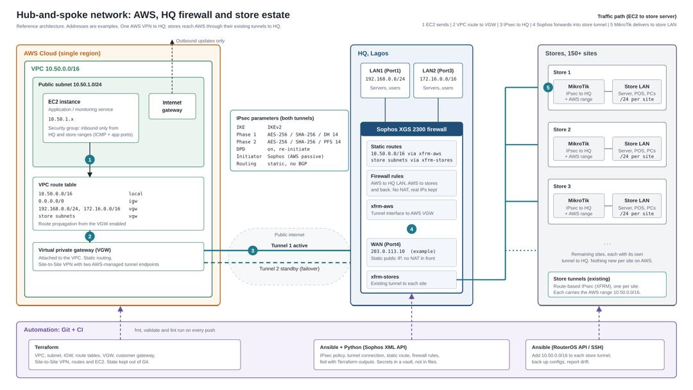

# Architecture

This project connects an AWS VPC to an enterprise HQ firewall and a MikroTik-based store estate (150+ sites) using a **hub-and-spoke** design. AWS gets **one** Site-to-Site VPN, to the HQ Sophos firewall. Stores already tunnel to HQ, so AWS workloads reach store networks through HQ without a separate AWS VPN per site.

> All addresses in the diagram and in this repository are examples (`203.0.113.0/24` is a reserved documentation range). Real addresses, keys and state files are never committed.

## Components

| Layer | Component | Role |
|---|---|---|
| AWS | VPC `10.50.0.0/16`, public subnet `10.50.1.0/24` | Hosts the EC2 application server |
| AWS | Internet gateway | Outbound updates only |
| AWS | Virtual private gateway (VGW) | AWS end of the Site-to-Site VPN, with two AWS-managed tunnel endpoints |
| AWS | Customer gateway | AWS's record of the HQ Sophos firewall (static public IP) |
| HQ | Sophos XGS 2300 | The hub: terminates the AWS tunnel and every store tunnel |
| HQ | LAN1 `192.168.0.0/24`, LAN2 `172.16.0.0/16` | HQ networks reachable from AWS |
| Stores | MikroTik router per site | Route-based IPsec tunnel to HQ, plus the AWS range |
| Control plane | Terraform, Ansible, Python | Build and configure everything from Git |

## Traffic path

An EC2 instance reaching a server at a store follows five steps. The numbers match the badges in the diagram.

1. **EC2 sends the packet.** The destination is a store server IP. The EC2 security group must allow the traffic in both directions.
2. **VPC route table sends it to the VGW.** Routes for the HQ and store ranges point at the VGW, either propagated from the VPN connection or added as static routes.
3. **IPsec tunnel to HQ.** Traffic crosses the public internet inside tunnel 1. Tunnel 2 stays up as standby.
4. **Sophos forwards it into the store tunnel.** A static route sends store subnets to the `xfrm-stores` interface, and firewall rules allow AWS to stores and back. NAT is off, so source addresses stay real.
5. **MikroTik delivers it to the store LAN.** The store router's tunnel policy includes the AWS range, so the reply returns the same way.

Replies take the same path in reverse. Both directions need a route, which is why the project configures routes on AWS, Sophos and each MikroTik.

## Routing

| Where | Route | Purpose |
|---|---|---|
| AWS VPC | HQ and store ranges via VGW | AWS to HQ and stores |
| Sophos | `10.50.0.0/16` via the AWS tunnel interface | HQ and stores to AWS |
| Sophos | Store subnets via the store tunnel interfaces | Hub forwarding |
| MikroTik | `10.50.0.0/16` added to the HQ tunnel policy | Store to AWS |

The AWS VPN uses **static routing**, so AWS only knows the networks listed in the VPN connection routes. Adding a new site means adding its subnet to the Terraform variable `onprem_cidrs` and to the Sophos routes.

## IPsec parameters

| Setting | Value |
|---|---|
| IKE version | IKEv2 |
| Phase 1 | AES-256, SHA-256, DH group 14 |
| Phase 2 | AES-256, SHA-256, PFS group 14 |
| Dead peer detection | On, re-initiate |
| Initiator | Sophos (the AWS side is passive) |
| Routing | Static, no BGP |

Parameters are pinned in Terraform on both tunnels so AWS does not offer a wide proposal list. Mismatched parameters are the most common reason a tunnel stays down.

## Why one VPN instead of one per store

- **Cost:** an AWS Site-to-Site VPN connection is billed per hour for as long as it exists. At roughly five US cents per hour (check current AWS pricing), 150 connections would cost thousands of dollars a month, compared with one for the whole estate.
- **Operations:** one AWS tunnel pair to monitor and rotate keys for, instead of 150.
- **Reuse:** the store-to-HQ tunnels already exist. AWS only needs a route to HQ.

The trade-off is that HQ becomes a single point of failure for AWS-to-store traffic, and all of it passes through the Sophos. Tunnel 2 protects against an AWS endpoint outage, not against HQ going down.

## Security

- The EC2 security group allows inbound traffic only from HQ and store ranges, on the required ports.
- Sophos firewall rules are limited to the AWS range and the networks it must reach. They are not "any to any".
- Preshared keys come from Terraform sensitive outputs. They are never written to files in the repository.
- `.gitignore` excludes state files, `.terraform/`, and `terraform.tfvars`. Only `terraform.tfvars.example`, with fake values, is committed.
- The Sophos API is enabled only for the automation host's IP, with a dedicated least-privilege account.
- Workloads that do not need inbound internet access should move to a private subnet with a NAT gateway. The public subnet is used here for the lab.

## Automation

| Tool | Scope |
|---|---|
| Terraform | VPC, subnet, internet gateway, route tables, VGW, customer gateway, VPN connection and routes, EC2. State is kept out of Git. |
| Python and Ansible | Sophos XML API: IPsec policy, tunnel connection, static route and firewall rules, using Terraform outputs as input. |
| Ansible | MikroTik RouterOS API or SSH: add the AWS range to each store tunnel, back up configs, report drift. |
| CI | `terraform fmt`, `terraform validate` and lint checks on every push. |

Terraform builds the infrastructure. Ansible and Python configure what runs inside the devices. The two connect through Terraform outputs, so tunnel addresses and keys are never copied by hand.

## Failure modes

| Failure | Effect | Response |
|---|---|---|
| AWS tunnel 1 endpoint down | Traffic fails over to tunnel 2 | Confirm DPD and the Sophos route for tunnel 2 |
| Internet link at HQ down | AWS loses access to all stores | Use the second WAN link on the Sophos, if available |
| One store tunnel down | Only that store is unreachable from AWS | Check the MikroTik tunnel and its policy |
| Route missing on one side | Tunnel shows UP but pings fail | Check routes on AWS, Sophos and the store router |
| Overlapping subnets | Traffic is routed to the wrong place | Keep every network on a unique range |

## Verification checklist

- [ ] Tunnel 1 shows **UP** in the AWS console
- [ ] Sophos can ping the AWS-side tunnel inside address
- [ ] EC2 can ping an HQ server
- [ ] EC2 can ping a store server through HQ
- [ ] Return traffic works (no asymmetric routing)
- [ ] Tunnel 2 takes over when tunnel 1 is disabled
- [ ] `terraform plan` shows no changes after a clean apply
- [ ] No keys, state files or real addresses appear in `git ls-files`

______________________________________________________________________________

# Architecture

This project connects an AWS VPC to an enterprise HQ firewall and a MikroTik-based store estate (150+ sites) using a **hub-and-spoke** design. AWS gets **one** Site-to-Site VPN, to the HQ Sophos firewall. Each store has its own IPsec tunnel to HQ, created by Ansible. AWS workloads reach store networks through HQ without a separate AWS VPN per site.

> All addresses in the diagram and in this repository are examples (`203.0.113.0/24` and `198.51.100.0/24` are reserved documentation ranges). Real addresses, keys and state files are never committed.

## Components

| Layer | Component | Role |
|---|---|---|
| AWS | VPC `10.50.0.0/16`, public subnet `10.50.1.0/24` | Hosts the EC2 application server |
| AWS | Internet gateway | Outbound updates only |
| AWS | Virtual private gateway (VGW) | AWS end of the Site-to-Site VPN, with two AWS-managed tunnel endpoints |
| AWS | Customer gateway | AWS's record of the HQ Sophos firewall (static public IP) |
| HQ | Sophos XGS 2300 | The hub: terminates the AWS tunnel and every store tunnel |
| HQ | LAN1 `192.168.0.0/24`, LAN2 `172.16.0.0/16` | HQ networks reachable from AWS and from the stores |
| Stores | MikroTik router per site (RouterOS 6) | Policy-based IPsec tunnel to HQ, including the AWS range |
| Control plane | Terraform and Ansible | Build and configure everything from Git |

## Traffic path

An EC2 instance reaching a server at a store follows five steps. The numbers match the badges in the diagram.

1. **EC2 sends the packet.** The destination is a store server IP. The EC2 security group must allow the traffic in both directions.
2. **VPC route table sends it to the VGW.** Routes for the HQ and store ranges point at the VGW, either propagated from the VPN connection or added as static routes.
3. **IPsec tunnel to HQ.** Traffic crosses the public internet inside tunnel 1. Tunnel 2 stays up as standby.
4. **Sophos forwards it into the store tunnel.** The store's connection on the Sophos lists the AWS range among its local networks, and firewall rules allow AWS to stores and back. NAT is off, so source addresses stay real.
5. **MikroTik delivers it to the store LAN.** The store router has a policy for the AWS range and a NAT exemption for it, so the reply returns the same way.

Replies take the same path in reverse. Both directions need the network on both ends of each tunnel, which is why the project configures AWS, the Sophos and each MikroTik together.

## Routing and tunnel networks

| Where | Entry | Purpose |
|---|---|---|
| AWS VPC | HQ and store ranges via VGW | AWS to HQ and stores |
| Sophos, AWS tunnel | `10.50.0.0/16` via the AWS tunnel interface | HQ and stores to AWS |
| Sophos, each store connection | Local networks: HQ LANs and the AWS range. Remote network: the store LAN | Traffic selectors for the store tunnel |
| MikroTik, each store | One policy per destination: each HQ LAN and `10.50.0.0/16` | Store to HQ and to AWS |
| MikroTik, each store | NAT accept rule per destination, above the masquerade | Keeps tunnel traffic from being rewritten |

In testing, a store connection with **Any / Any** networks did not carry traffic for the private networks against a policy-based MikroTik. Each store connection therefore lists explicit network objects, and the same networks must appear in the router's policies. When a new range is added, change both ends.

The AWS VPN uses **static routing**, so AWS only knows the networks listed in the VPN connection routes. Adding a new site means adding its subnet to the Terraform variable `onprem_cidrs` and to the store's connection on the Sophos.

## IPsec parameters

| Setting | Value |
|---|---|
| IKE version | IKEv2 |
| Phase 1 | AES-256, SHA-256, DH group 14 |
| Phase 2 | AES-256, SHA-256, PFS group 14 |
| Store tunnel lifetimes | Phase 1 8 hours, phase 2 1 hour |
| Dead peer detection | On, re-initiate |
| Initiator | Sophos (the AWS side and the store routers respond) |
| Authentication | Preshared key, one per tunnel |

Parameters are pinned in Terraform on both AWS tunnels so AWS does not offer a wide proposal list, and they are set to the same values on every store tunnel. Mismatched parameters or network lists are the most common reason a tunnel stays down.

## Why one AWS VPN instead of one per store

- **Cost:** an AWS Site-to-Site VPN connection is billed per hour for as long as it exists. At roughly five US cents per hour (check current AWS pricing), 150 connections would cost thousands of dollars a month, compared with one for the whole estate.
- **Operations:** one AWS tunnel pair to monitor and rotate keys for, instead of 150.
- **Reuse:** every store needs a tunnel to HQ anyway, and Ansible creates it. AWS only needs a route to HQ.

The trade-off is that HQ becomes a single point of failure for AWS-to-store traffic, and all of it passes through the Sophos. Tunnel 2 protects against an AWS endpoint outage, not against HQ going down.

## Security

- The EC2 security group allows inbound traffic only from HQ and store ranges, on the required ports.
- Sophos firewall rules are limited to the AWS range and the networks it must reach. They are not "any to any".
- Each store tunnel has its own preshared key, generated once and kept in Ansible Vault. Keys are never written to files in the repository.
- `.gitignore` excludes state files, `.terraform/`, `terraform.tfvars`, the real inventory, local settings and every vault file. Only example files with fake values are committed.
- The Sophos API is enabled only for the automation host's IP, with a dedicated least-privilege account.
- Store routers accept SSH only from the HQ public IP. The automation account is read-only by default and gets write access only while a change is applied.
- Workloads that do not need inbound internet access should move to a private subnet with a NAT gateway. The public subnet is used here for the lab.

## Automation

| Tool | Scope |
|---|---|
| Terraform | VPC, subnet, internet gateway, route tables, VGW, customer gateway, VPN connection and routes, EC2. State is kept out of Git. |
| Ansible, Sophos XML API | Network objects and the IPsec connection for the AWS tunnel and for each store. |
| Ansible, MikroTik over SSH | IKE profile, proposal, peer, identity, policies and NAT exemption on each store router. |
| CI (planned) | `terraform fmt`, `terraform validate` and `ansible-lint` on every push. |

Terraform builds the infrastructure. Ansible configures what runs inside the devices. The two connect through Terraform outputs for the AWS tunnel, and through the inventory for the stores.

The MikroTik playbook is built to be repeated. Each task checks whether its object exists before creating it, and the playbook ends with a read-back that counts the objects and fails if any is missing. A second run reports no changes.

## Failure modes

| Failure | Effect | Response |
|---|---|---|
| AWS tunnel 1 endpoint down | Traffic fails over to tunnel 2 | Confirm DPD and the Sophos route for tunnel 2 |
| Internet link at HQ down | AWS loses access to all stores | Use the second WAN link on the Sophos, if available |
| One store tunnel down | Only that store is unreachable from AWS | Check the store connection on the Sophos and the router's policies |
| Network lists differ between the Sophos and the router | IKE comes up but traffic does not pass | Compare the connection's networks with the router's policies |
| Route missing on one side | Tunnel shows UP but pings fail | Check routes on AWS, the Sophos and the store router |
| Gateway type reset on the Sophos | Tunnel never initiates | Set it to Initiate and re-run the playbook |
| Overlapping subnets | Traffic is routed to the wrong place | Keep every network on a unique range |

## Verification checklist

- [ ] Tunnel 1 shows **UP** in the AWS console
- [ ] Sophos can ping the AWS-side tunnel inside address
- [ ] Each store tunnel shows connected on the Sophos and has a phase 2 state on the router
- [ ] EC2 can ping an HQ server
- [ ] EC2 can ping a store server through HQ
- [ ] Return traffic works (no asymmetric routing)
- [ ] Tunnel 2 takes over when tunnel 1 is disabled
- [ ] `terraform plan` shows no changes after a clean apply
- [ ] A second run of the MikroTik playbook reports `changed=0`
- [ ] No keys, state files or real addresses appear in `git ls-files`
